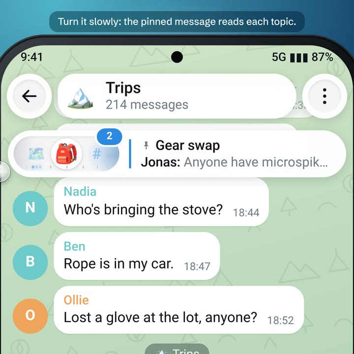
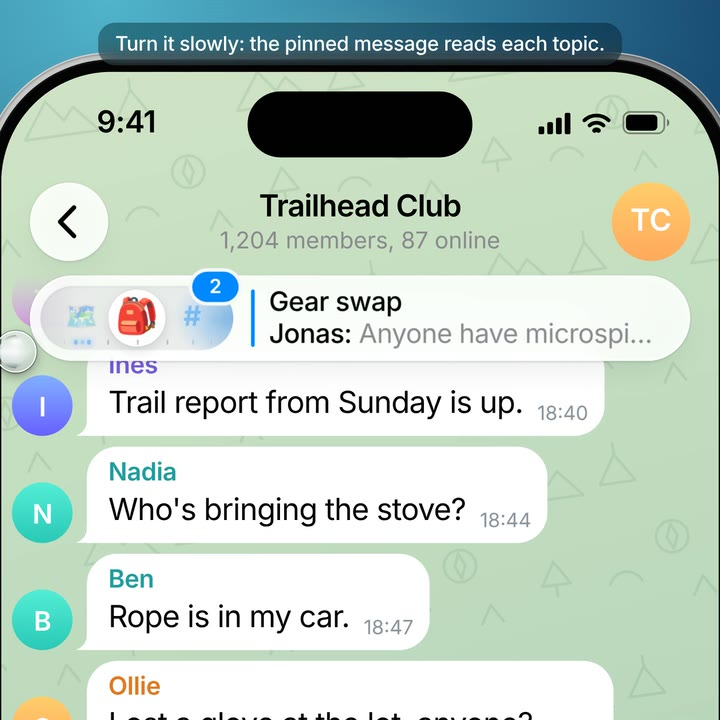

# Topic Dial

Roll a forum group's topic tabs up into a little wheel that shares one glass island with the pinned message,
like a radio: the wheel is the dial and the pinned message is its display. The chat gets the tabs' row back,
and switching topics takes one swipe. For Telegram Android and Telegram iOS.

| Android | iOS |
| --- | --- |
| [](demo-android.mp4) | [](demo-ios.mp4) |
| [Watch the demo (45 s)](demo-android.mp4) | [Watch the demo (45 s)](demo-ios.mp4) |

## How it works

1. In a forum group shown as tabs, tap **«** at the end of the tab bar. The bar winds up into a wheel, set into
   one glass island with the pinned message.
2. Swipe the wheel to switch topics. It clicks at every topic, and while it turns, the pinned message becomes a
   display that reads the topic under the lens: its name, its unread count and its latest message.
3. Tap the wheel to roll every topic out across the row. Pick one: the glass glides over to it, the topic opens
   in one piece, and the bar winds back up.
4. News lights up on the wheel's scale like stations on a radio dial, and where someone is typing, its light
   turns into moving dots.
5. Side tabs roll up into a wheel standing up at the top of the rail, and a bottom bar into a wheel right by
   your thumb. **Keep open** brings the classic tabs back, and each group remembers the choice.

## Why

- The topic bar takes a whole row (or a 64 dp rail) in every forum, all the time. Rolled up, the chat gets that
  space back, and the pinned message gets a job.
- It keeps what the tabs do well: every topic is one swipe or one tap away, news and typing still show, and the
  bar keeps Telegram's own counters.
- It's cheap to ship: client-only, no API or server changes, built on each app's own topic tabs and pinned
  message.

## Contents

- `demo-android.mp4`, `demo-ios.mp4`: the demos, rebuilds of the screen that follow the patches (not screen
  recordings)
- `topic-dial-android.patch`: the patch for [Telegram Android](https://github.com/DrKLO/Telegram) 13.1.1, and
  `topic-dial-android-12.10.6.patch` for 12.10.6
- `topic-dial-ios.patch`: the patch for [Telegram-iOS](https://github.com/TelegramMessenger/Telegram-iOS) 13.1
- `android/` and `ios/`: the changed source files from the patches (Android as on 13.1.1), for easy reading
- [IMPLEMENTATION.md](IMPLEMENTATION.md): how it works in detail, the code, and what was checked
- `tools/demo/`: the web rebuild of the screen that renders the demos
- `tools/ios-typecheck/`: type-checks the iOS code anywhere Swift runs

## Try it

Android, on Telegram Android 13.1.1 (build 7237):

```bash
git clone https://github.com/DrKLO/Telegram.git && cd Telegram
git checkout 3de37c8cfb039452be7398909461da6288babf15
git apply /path/to/topic-dial-android.patch
```

Then build as usual, with your own `api_id` and `api_hash`. On 12.10.6 (build 7112), check out
`f2908b14133bbffbf7ab04f641ecb5bfaf533242` and apply `topic-dial-android-12.10.6.patch` instead: the app built
from that one has been installed and used on a phone.

iOS, on Telegram-iOS 13.1:

```bash
git clone https://github.com/TelegramMessenger/Telegram-iOS.git && cd Telegram-iOS
git checkout 1dd3e7f4ed5d72caed1caa04033832c28a5920f5
git apply --whitespace=nowarn /path/to/topic-dial-ios.patch
```

It hasn't been built with Xcode yet: its new code type-checks against the real APIs' signatures, and the rest
was checked by reading it against the APIs it calls (see [IMPLEMENTATION.md](IMPLEMENTATION.md)).

## License

GPL-2.0, like the Telegram apps it changes. See [LICENSE](LICENSE).

---

Suggested by [@zunem001](https://t.me/zunem001)
